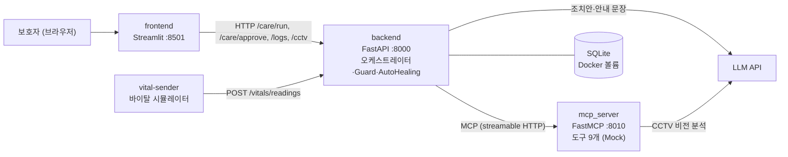
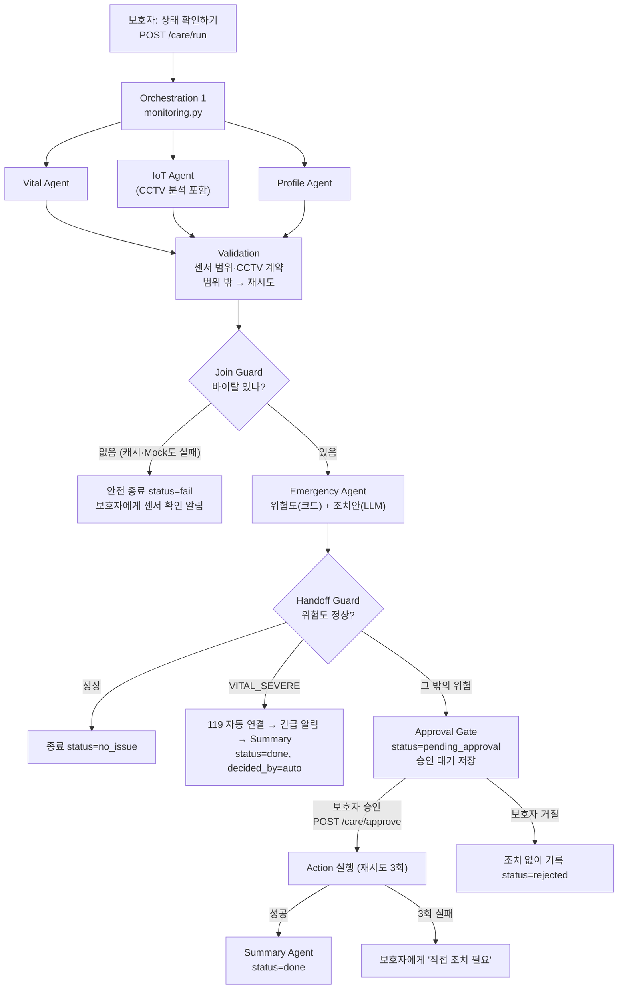

# 산출물 1｜멀티 에이전트 아키텍처 설계서

> 바이탈·IoT·긴급대응 멀티 에이전트 기반 노인 케어 시스템 (온기케어)
> 기준: `main` 2026-10-12 (커밋 `b1e9b0b`), README·`docs/scenarios.md`·실제 코드 대조
> ⚠️ 바이탈·기기·CCTV 데이터는 모두 시연용 가상 데이터이며, 위험 판정 기준은 의학적 기준이 아닌 시연용 예시 규칙입니다.

---

## 1. 프로젝트 목적과 대표 사용자 시나리오

### 목적
떨어져 사는 **보호자 한 명이 어르신 한 분**의 상태를 한 화면에서 확인하고, 위급할 때 **승인 한 번으로** 대응할 수 있게 합니다.
센서·기기·LLM에 장애가 나도 재시도·캐시·대체 경로로 스스로 복구하고, 끝까지 복구되지 않으면 보호자에게 직접 조치를 요청합니다 (AutoHealing).

### 해결하려는 문제
- 보호자는 바이탈, 실내 온습도, 가전 상태, CCTV를 따로 확인해야 해서 놓치기 쉽습니다.
- 위급 상황에서 무엇을 해야 할지 판단하고 실행하는 데 시간이 걸립니다.
- 센서·외부 모델이 실패하면 시스템이 조용히 멈추거나 잘못된 "정상"을 보여 줄 위험이 있습니다.

### 전체 흐름 한 문장
> 보호자가 로그인해 상태 확인을 요청하면, 바이탈·IoT(실내 온습도·기기·CCTV)·취약도를 **병렬로** 확인하고, 이상이 있을 때만 긴급상황 에이전트가 조치안을 만들어 **보호자에게 승인을 요청**하며, 승인되면 조치를 실행하고 결과를 보호자와 어르신에게 안내한다. (바이탈이 매우 위험하면 승인 없이 119에 바로 연결)

### 대표 시나리오 (시연 1번)
보호자 B가 로그인 → "상태 확인하기" → 실내 33℃·심박 105회/분 확인 → 위험도 **경고** (판정 근거: 실내 극한 고온 + 심박·혈압 변화) → 조치안 "에어컨 냉방 26℃로 켜기" 승인 요청 → 보호자 승인 → 에어컨 켜기(Mock) → 보호자·어르신 안내.

| 시연 | 보호자 | 시나리오 | 결과 |
|---|---|---|---|
| 1 | B | `heat` | 경고 → 에어컨 냉방 승인 |
| 2 | C | `induction` | 주의 → 인덕션 끄기 승인 |
| 3 | A | `fall` | CCTV 쓰러짐 의심 → 위급 → 119 승인 요청 |
| 4 | D | `critical` | 바이탈 위험 범위 3개 → 위급 → **119 자동 연결** |
| 5~8 | | 위 시나리오 + 장애 주입 4종 | AutoHealing 시연 (산출물 2) |

### 역할을 나눈 이유
- 바이탈·집 안 기기·프로필은 서로 독립적인 정보라 **병렬로** 확인하면 빠르고, 한쪽 센서가 고장 나도 나머지는 살릴 수 있습니다.
- **판정(코드 규칙)** 과 **문장 작성(LLM)** 을 나눠, 판단은 일관되고 검증 가능하게, 안내는 읽기 쉽게 만듭니다. LLM이 실패해도 위험도는 코드가 정하므로 그대로 나옵니다.
- 사람의 판단이 필요한 조치(기기 제어, 119)는 **승인 단계**로 분리해 에이전트가 마음대로 실행하지 않게 합니다.

---

## 2. 아키텍처 선택

| 항목 | 내용 |
|---|---|
| 구조 | **오케스트레이터 중앙 조정형** + 2단계 오케스트레이션(모니터링 → 긴급 대응) + 승인 게이트 |
| 선정 이유 | ① 에이전트 호출 순서·병렬 실행·종료 판단을 한 곳(`orchestrator/`)에서 관리 ② Guard·Validation을 **코드 규칙**으로 두어 LLM 없이도 판정이 재현됨 ③ 승인 게이트에서 흐름을 끊어 보호자 결정 전에는 조치가 실행되지 않음 ④ 도구는 MCP 서버로 분리해 백엔드가 도구 장애와 격리됨 |
| 고려사항 | 오케스트레이터(백엔드)가 단일 지점 → 각 에이전트는 실패해도 예외 대신 빈 값·오류 코드를 반환하도록 만들어 전체 흐름이 멈추지 않게 함. 승인 대기 상태는 메모리에 있어 백엔드 재시작 시 사라짐(점검 결과 6장) |

### 시스템 구성

| 구성요소 | 기술 | 역할 |
|---|---|---|
| frontend | Streamlit | 보호자 로그인(데모 계정), 위험도 배너, 조치안 승인/거절, 측정값 카드, AutoHealing 로그 |
| backend | FastAPI | 오케스트레이터, Guard·Validation, 승인 대기, AutoHealing, `/care/run` `/care/approve` `/logs` `/cctv/{name}` `/vitals/readings` `/health` |
| mcp_server | FastMCP | 바이탈·실내 환경·기기·CCTV·병원·알림·119 도구 (모두 Mock, 실패 시 예외를 그대로 던짐) |
| vital-sender | Python | 가상 어르신 4명의 바이탈을 주기적으로 백엔드에 전송 (실시간 값·캐시의 출처) |
| SQLite | sqlite3 | 프로필, 바이탈 이력, 캐시, 실행 로그 |
| LLM | OpenAI 또는 Gemini | CCTV 이미지 분석, 조치안 문장, 보호자·어르신 안내 (판정은 하지 않음) |

---

## 3. 에이전트별 역할·책임·입력·출력

| 에이전트 | 코드 위치 | 주요 역할 | 하지 않는 일 (제한) | 입력 | 출력 |
|---|---|---|---|---|---|
| **Orchestrator** | `backend/src/orchestrator/care.py`, `monitoring.py`, `emergency.py`, `approval_flow.py`, `auto_119.py` | 호출 순서·병렬 실행, Guard 판단, 승인 대기 저장, 조치 실행, 최종 상태 결정, `run_id` 관리 | 도구 직접 구현 금지, 위험도 직접 판정 금지, 승인 없이 조치 실행 금지(`VITAL_SEVERE` 119만 예외) | `CareRunRequest`, `CareApprovalRequest` | `CareRunResponse`, `CareApprovalResponse`, `current_step` |
| **Vital Agent** | `backend/src/agents/vital.py` | 시뮬레이터 최신값(45초 이내) → 재시도 → 캐시 → MCP Mock 순으로 바이탈 조회 | 진단 금지, 실패를 숨기지 않음(출처 `source` 표시) | `profile_id`, `scenario`, `fault` | `vital`, `source`(live/cache/mock), 오류 코드 |
| **IoT Agent** | `backend/src/agents/iot.py` | 실내 온습도·기기 상태 조회(3회), CCTV 캡처 → 분석 요청(2회) | 승인 없는 기기 제어 금지, 이미지에 없는 내용 추측 금지 | `profile_id`, `scenario`, `fault` | `indoor_environment`, `devices`, `cctv`, 오류 코드 |
| **Profile Agent** | `backend/src/agents/profile.py` | 취약도(상/중/하) 계산 (나이·독거·지병 유무·거동 불편) | 질병 진단·지병명 전달 금지. 값이 없으면 위험한 쪽(상) | DB 프로필 | `vulnerability`, `area` |
| **Emergency Agent** | `backend/src/agents/emergency.py`, `rules/risk.py` | 규칙표로 위험도·축별 단계·낙상 상태·자동 119 여부 판정(코드), 조치 종류 선택(코드), 조치안 문장(LLM), 병원 정보 | 위험도·조치 종류를 LLM이 정하지 않음, 입력에 없는 수치·장소 생성 금지 | `CareStatusResult` | `EmergencyResult` |
| **Summary Agent** | `backend/src/agents/summary.py` | 승인·실행 결과로 보호자용·어르신용 안내문 작성(LLM, 실패 시 템플릿) | 질병·약 조언 금지, 어르신용에 CCTV·수치 포함 금지, 실패한 조치를 "완료"로 쓰지 않음 | 승인 여부, 실행 결과, `EmergencyResult` 문맥 | `guardian_message`, `elder_message` |
| **CCTV 분석** (MCP 도구) | `mcp_server/src/vision/analyzer.py`, `tools/cctv.py` | 캡처 이미지를 비전 LLM에 넣어 사실 4개(사람 보임, 자세, 쓰러짐 의심, 설명) 반환 | "의심" 수준으로만 표현, 보이지 않는 것 추측 금지 | `image_path` | `person_visible`, `posture`, `fall_suspected`, `description` |

에이전트가 아닌 공통 계층:

| 계층 | 코드 위치 | 역할 |
|---|---|---|
| Validation | `backend/src/orchestrator/validation.py`, `schemas.py` | 센서 오류 범위와 CCTV 출력 계약 검사 → 범위 밖이면 재시도 대상 |
| Guards | `backend/src/orchestrator/guards.py` | Join Guard(바이탈 최종 실패 → 안전 종료), Handoff Guard(정상 → 종료) |
| AutoHealing | `backend/src/healing/` | 제한 재시도, 캐시 대체, 장애 주입, 실행 로그, 복구 지표 (산출물 2) |
| MCP 클라이언트 | `backend/src/mcp_client.py` | 도구 호출. 연결 실패(`McpConnectionError`, 재시도 대상)와 도구 오류(`McpToolError`)를 구분 |

> **원칙: LLM은 판단하지 않고 전달만 한다.** 위험도·조치 종류·승인 필요 여부는 코드 규칙이 정합니다.

---

## 4. 협업 흐름 (정상·재시도·실패·종료)

| 상태 | 조건 | 다음 경로 |
|---|---|---|
| 정상 | 위험도 "정상" | `no_issue`로 종료 (알림 피로 방지) |
| 승인 대기 | 위험도 주의·경고·위급 + 승인 필요한 조치 | `pending_approval` → 보호자 결정 |
| 자동 실행 | 바이탈 위험 범위 2개 이상 + 점수 합 7점 이상 + 최신 측정값 | 승인 없이 119 → `done`(`decided_by: auto`) |
| 재시도 | 조회 시간 초과·연결 실패·검증 실패(범위 밖, 형식 오류) | 정해진 횟수만큼 재시도 → 캐시·대체 결과 |
| 부분 실패 | CCTV 분석 실패, 실내·기기 조회 실패 | 빠진 정보 없이 진행 ("영상 판단 불가" 등 표시) |
| 실패 종료 | 바이탈 최종 실패 | `fail` + 보호자에게 센서 확인 알림 |
| 조치 실패 | 승인한 조치가 3회 실패 | 보호자에게 "직접 조치 필요" |

**무한 실행 방지:** 모든 재시도는 횟수가 고정되어 있습니다(조회 3회, CCTV 2회, 조치 3회, LLM 교정 1회 후 템플릿). 승인 대기는 시간이 지나도 자동 실행하지 않고 다시 알림만 합니다(`ENABLE_TIMEOUT_119 = False`).

---

## 5. Handoff 조건과 전달 데이터

### 5-1. 단계별 Handoff

| 단계 | 보내는 쪽 → 받는 쪽 | 전달 데이터 (스키마, `backend/src/schemas.py`) | 조건 |
|---|---|---|---|
| 요청 | frontend → Orchestrator | `CareRunRequest {profile_id, scenario, fault[]}` | 보호자 로그인 후 "상태 확인하기" |
| 모니터링 결과 | Orchestration 1 → 2 | `CareStatusResult` | Join Guard 통과 |
| 판정 결과 | Emergency Agent → Approval Gate | `EmergencyResult` | Handoff Guard 통과 (정상이 아님) |
| 승인 대기 | Orchestrator → 승인 저장소 | `{care_status, emergency, raw(문맥), fault, created_at}` (`orchestrator/approval.py`, `run_id` 기준) | `requires_approval` |
| 보호자 결정 | frontend → Orchestrator | `CareApprovalRequest {run_id, decision: approve/reject}` | 승인 대기 존재 |
| 조치 결과 | Action → Summary | `ActionResult {tool, status, message, recovery}` → `ExecutedAction` | 승인 또는 자동 119 |

### 5-2. 주요 필드 (가이드의 Handoff 항목과 대응)

| 가이드 항목 | 이 프로젝트 필드 | 예시 |
|---|---|---|
| task_id | `run_id` | `run-5ee33805` (모든 단계·로그에 동일) |
| from / to | 스키마 종류로 구분 (`CareStatusResult` → `EmergencyResult` → `ActionResult`) | |
| objective | `scenario` | `heat` |
| inputs | `vital`, `indoor_environment`, `devices`, `cctv`, `vulnerability`, `area` | 심박 105, 실내 33℃ |
| constraints | `ProposedAction.needs_approval`, `requires_approval` | 기기 제어는 승인 필요 |
| expected_output | `EmergencyResult.reasons`, `proposed_actions`, `axes`, `fall_state`, `auto_119` | "실내 온도 극한", 에어컨 냉방 |
| attempt | `CareStatusResult.attempt`, `run_logs.attempt` | 재시도 회차 |
| 실패 원인 | `CareStatusResult.errors`, `run_logs.error` | `vital_unavailable`, `InjectedFault` |
| 데이터 출처 | `CareStatusResult.source` | `live` / `cache` / `mock` / `mixed` |

### 5-3. Handoff 점검 원칙 (구현 반영)
- 모든 응답과 로그에 `run_id`가 붙어 승인 단계까지 같은 실행을 추적합니다.
- 실패 원인은 원문 메시지가 아니라 **오류 종류 코드**만 로그에 남깁니다 (`InjectedFault`, `NoRecentReading` 등).
- CCTV는 이미지 자체가 아니라 **파일 경로와 분석 결과**만 전달합니다.
- 지병명 원문은 전달하지 않고 **취약도(상/중/하)** 만 전달합니다.
- API 키는 `.env`에만 두며 메시지·로그·응답에 포함하지 않습니다.

---

## 6. 공유 상태·메모리·중간 결과 관리

| 저장소 | 위치 | 내용 | 수명 |
|---|---|---|---|
| `profiles` | SQLite | 가상 어르신 4명 (나이, 독거, 지병 유무, 거동 불편, 지역) | 볼륨에 영구 |
| `vital_readings` | SQLite | 시뮬레이터가 보낸 바이탈 이력 (측정 시각·수신 시각) | 볼륨에 영구 |
| `cache` | SQLite | 마지막 **정상** 조회 결과 (장애 시 대체 수단). Mock 값은 저장하지 않음 | 볼륨에 영구 (최대 사용 나이 300초) |
| `run_logs` | SQLite | 단계·시도·상태(success/retry/fallback/fail/error)·오류 종류·복구 방법·소요 시간 | 볼륨에 영구, `GET /logs?run_id=` |
| 승인 대기 | 백엔드 메모리 (`PendingApprovals`) | 판정 결과와 Summary 문맥 | **백엔드 재시작 시 사라짐** |
| 화면 상태 | Streamlit `session_state` | 로그인 계정, 실행 응답, 승인 결과 | 브라우저 세션 |

---

## 7. Validation 규칙 (코드 규칙)

| 대상 | 규칙 | 실패 시 |
|---|---|---|
| 바이탈 센서 범위 (`VitalData`) | 심박 20~250, 수축기 혈압 50~260, 체온 30~43℃, SpO₂ 50~100% | 검증 실패 → 재시도 대상 |
| 실내 온도 (`IndoorEnvironment`) | -10~60℃ (습도만 잘못되면 습도만 비우고 온도는 유지) | 재시도 대상 |
| CCTV 출력 계약 | `status: analyzed`면 필수 4항목(`person_visible`, `posture`, `fall_suspected`, `description`)과 자료형 | "영상 판단 불가"로 바꿔 바이탈 중심 판정 |
| LLM 출력 | JSON 파싱, 필수 키, 개수 일치, 금지 표현 | 교정 재요청 1회 → 템플릿 |

센서 범위는 위험도 기준이 아니라 **입력 오류를 거르는 넓은 범위**입니다. 위험 범위(예: 심박 ≥131)와 시연 값은 모두 이 범위 안쪽이라, 진짜 위험 수치가 오류로 버려지지 않습니다.

---

## 8. 역할 중복 및 책임 공백 점검 결과

| 점검 항목 | 결과 | 조치 |
|---|---|---|
| 위험도 판정 주체 | Emergency Agent의 코드 규칙(`risk.py`) 한 곳 | 중복 없음. LLM·화면은 판정하지 않음 |
| 승인 필요 여부 | `risk.py`가 조치마다 `needs_approval` 결정 | 오케스트레이터는 그대로 따름 |
| 재시도 주체 | AutoHealing(`healing/`) 한 곳 | LLM SDK 자체 재시도는 끔 (`MAX_RETRIES = 0`) — 중복 재시도 방지 |
| CCTV 분석 재시도 | backend 2회 × MCP 내부 비전 LLM 3회 | **공급자 호출이 최대 6회**까지 늘 수 있음 (공백은 아니지만 비용 주의) |
| 검증 위치 | 스키마 범위 + `validation.py` + 복구 계층 검증 함수 | 같은 규칙을 공유하도록 정리됨 |
| 승인 대기 저장 | 메모리 | **공백:** 재시작 시 대기 중인 승인이 사라짐 → 시연 중 재시작 금지, 개선 과제 |
| 보호자 인증 | 프런트 데모 계정만 | **공백:** 백엔드는 요청자를 확인하지 않음 (시연용, README 15장에 명시) |
| 담당자(운영자) 알림 | 보호자 알림은 Mock 도구로 구현 | **공백:** 운영 담당자에게 장애를 알리는 채널 없음 (산출물 2·3) |
| 60초 무응답 자동 119 | 쓰지 않기로 결정, 코드에서 꺼짐 | 승인 없는 119는 `VITAL_SEVERE` 하나뿐 |

---

## 9. 제출 전 체크리스트

| 항목 | 상태 | 근거 |
|---|---|---|
| 에이전트별 역할과 책임 범위가 명확하다 | ✅ | 3장 표, 코드 위치 명시 |
| 역할의 중복과 책임 공백을 점검했다 | ✅ | 8장 (공백 3건 기록) |
| Handoff 조건과 전달 데이터가 실제 구현과 일치한다 | ✅ | 5장, `schemas.py` 기준 |
| 상태·메모리·중간 결과의 전달 방식을 설명할 수 있다 | ✅ | 6장 |
| 재시도·실패·종료 조건이 정의되어 있다 | ✅ | 4장, 산출물 2 재시도 표 |
