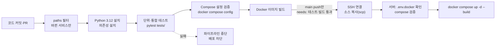

# 산출물 3｜파이프라인 구현 결과 보고서

> 바이탈·IoT·긴급대응 멀티 에이전트 기반 노인 케어 시스템 (온기케어)
> 기준: `main` 2026-10-12 (커밋 `b1e9b0b`), `.github/workflows/` 3개 파일
> 실행 ID·시각·로그 링크는 GitHub Actions 화면에서 확인한 실제 값으로 채웁니다. 이 문서는 확인하지 않은 값을 지어내지 않았습니다 (5장 "기입 필요").

---

## 1. 파이프라인 구성

서비스마다 독립된 워크플로가 있고, **바뀐 폴더의 서비스만** 실행됩니다.

| 워크플로 | 파일 | 실행 조건 (paths) | 배포 대상 (GitHub environment) |
|---|---|---|---|
| Backend CI CD | `.github/workflows/backend-ci.yml` | `backend/**` | `backend_server` |
| Frontend CI CD | `.github/workflows/frontend-ci.yml` | `frontend/**` | `frontend_server` |
| MCP Server CI CD | `.github/workflows/mcp-server-ci.yml` | `mcp_server/**` | `mcp_server` |

| 이벤트 | 동작 |
|---|---|
| Pull Request | 테스트·빌드만 실행 (**배포 안 함**) |
| `main`에 push (PR merge) | 테스트·빌드 → 통과하면 배포 |
| 수동 실행 (`workflow_dispatch`) | `deploy` 입력을 켰을 때만 배포 |

### 전체 흐름

---

## 2. 단계별 정의

| 단계 | 입력 | 출력 | 성공 조건 | 실패 처리 |
|---|---|---|---|---|
| 소스 받기·환경 준비 | 커밋 | 작업 공간, Python 3.12 | 의존성 설치 완료 | 작업 중단 |
| 문법 검사 (frontend만) | `frontend/src` | — | `python -m compileall -q src` 통과 | 작업 중단 |
| 테스트 | `tests/`, 테스트 데이터 | pytest 결과 | **전체 통과** | 작업 실패 → **배포 작업 실행 안 됨** |
| Compose 검증 | `deploy/compose.yml`, `.env.docker.example` | — | `docker compose config --quiet` 통과 | 작업 실패 → 배포 차단 |
| 이미지 빌드 | Dockerfile, 소스 | 서비스 이미지 | 빌드 성공 | 작업 실패 → 배포 차단 |
| 배포: SSH 준비 | GitHub Secrets (SSH 키, known_hosts, 서버 주소·사용자) | SSH 연결 | 연결 성공 | 배포 실패 (서버 변경 없음) |
| 배포: 소스 복사 | 서비스 폴더 | 서버 `~/<서비스>/` | `scp` 성공 | 배포 실패 |
| 배포: 서버 실행 | 서버의 `.env.docker` | 실행 중인 컨테이너 | `.env.docker` 존재, compose 검증, `up -d --build` 성공 | `.env.docker`가 없으면 진단 정보를 출력하고 중단 |

- 동시 실행 제어: `concurrency` 그룹을 서비스·브랜치별로 두고 `cancel-in-progress: false` (배포 중에 다른 실행이 끼어들지 않음)
- 권한: `permissions: contents: read` (저장소 읽기만)
- 서버 디스크 관리: 배포 전 `docker system prune --all --force`로 이전 이미지를 정리

---

## 3. 테스트 데이터와 기준

### 3-1. 테스트 구성

| 서비스 | 테스트 수 (2026-10-12, `b1e9b0b`, 로컬 실행) | 주요 내용 | 테스트 데이터 |
|---|---:|---|---|
| backend | 484 (481 통과, 3 실패*) | 위험도 규칙표·축·낙상 판정, `/care/run`·`/care/approve` 통합, AutoHealing 재시도·캐시·장애 주입, Validation 범위, `/logs`, `/cctv`, 바이탈 저장·마이그레이션 | 시나리오 5종 mock 값, 가짜 MCP, 임시 SQLite |
| mcp_server | 151 (모두 통과) | 도구 9개 반환 형식, CCTV 이미지 경로, 비전 분석 계약, 바이탈 시뮬레이터 | `mock_data.py` 시나리오·프로필 |
| frontend | 94 (모두 통과) | 데모 계정 로그인, 위험도 배너·조치안 순서, 측정값 카드, 진행 표시, AutoHealing 로그 화면 | Streamlit AppTest + 가짜 API 응답 |

\* backend 3개 실패는 **Windows 로컬에서만** 발생합니다. `test_partial_vitals.py`의 DB 마이그레이션 테스트 3개가 `schema.sql`을 인코딩 지정 없이 읽어, 한국어 Windows 기본 인코딩(cp949)에서 `UnicodeDecodeError`가 납니다. GitHub Actions는 Linux(UTF-8)에서 실행하므로 파이프라인에는 영향이 없을 것으로 보이나, CI 실행 결과로 확인이 필요합니다. 수정 방법: 테스트에서 `read_text(encoding="utf-8")` 사용.

### 3-2. 통과 기준
- 서비스별 **pytest 전체 통과**가 배포 조건입니다 (한 개라도 실패하면 배포하지 않음).
- 핵심 시나리오(위험 4종 + 장애 4종)는 backend 통합 테스트에 기대 결과로 들어 있습니다 (`docs/scenarios.md` 8장 기대값과 일치).
- 코드 커버리지는 **측정하지 않습니다** (커버리지 도구 미도입). 개선 과제입니다.

---

## 4. 테스트 실패 시 배포 차단 정책

| 정책 | 구현 위치 | 동작 |
|---|---|---|
| 테스트 통과 후에만 배포 | `deploy` 작업의 `needs: test-and-build` (frontend는 `validate-and-build`) | 테스트·빌드 작업이 실패하면 배포 작업이 아예 실행되지 않음 |
| PR에서는 배포 안 함 | `deploy`의 `if: github.event_name == 'push' && github.ref == 'refs/heads/main'` | PR은 검증만 |
| 설정 오류 차단 | `docker compose config --quiet` (CI와 서버 양쪽) | 잘못된 compose·환경 파일이면 중단 |
| 서버 환경 파일 확인 | 원격 스크립트의 `.env.docker` 존재 검사 | 없으면 위치 진단 출력 후 `exit 1` |

> 한계: 배포 실패 시 **이전 버전으로 자동 롤백하지 않습니다.** `up -d --build`가 실패하면 서버에는 실패 직전 상태가 남습니다. 배포 후 상태 확인(`/health`)도 자동으로 하지 않습니다.

---

## 5. 실제 실행 결과

### 5-1. 실행 기록표

GitHub Actions에서 아래 커밋의 실행을 열어 값을 채웁니다.

| 항목 | 예: PR #49 merge | 예: PR #52 merge |
|---|---|---|
| Commit | `bcacede` (첫 화면 위험도 배너) | `5a14348` (사이드바 수정) |
| 워크플로 | Frontend CI CD | Frontend CI CD |
| Pipeline ID | 기입 필요 | 기입 필요 |
| 시작·종료 시각 | 기입 필요 | 기입 필요 |
| 테스트 | 기입 필요 (통과 수 / 전체 수) | 기입 필요 |
| 배포 결과 | 성공 — 배포 화면에서 새 배치 확인 (54.180.32.22:8501) | 기입 필요 |
| 총 실행시간 | 기입 필요 | 기입 필요 |
| 알림 전송 | 해당 없음 (알림 단계 없음, 6장) | 해당 없음 |
| 로그 URL | 기입 필요 | 기입 필요 |

### 5-2. 2026-10-12 main에 반영된 주요 PR (배포 실행 후보)

| 시각 | merge 커밋 | PR | 실행되는 워크플로 |
|---|---|---|---|
| 14:55 | `5a14348` | #52 사이드바 다시 열기 수정 | Frontend |
| 14:47 | `bcacede` | #49 첫 화면 위험도 배너·조치안 | Frontend |
| 14:37 | `604bbda` | #40 LLM 파트 문서 정리 | (문서·코드 변경 범위에 따름) |
| 14:37 | `fc0c718` | #45 온기케어 테마 | Frontend |
| 13:58 | `63d6e81` | #44 비전 테스트 수정 | MCP Server |
| 13:27 | `c4ddbde` | #43 보호자 화면 | Frontend |
| 12:35 | `1dd15e8` | #42 지혜 (스키마·Validation·`/logs`) | Backend |
| 12:07 | `848bc73` | #41 AutoHealing 로그·카드·진행 표시 | Frontend |

### 5-3. 테스트·배포 과정에서 발견·수정한 사례
| 사례 | 발견 방법 | 내용 |
|---|---|---|
| 작업 방식 전환 | 운영 판단 | 초기에 폴더 구조 변경을 main에 바로 push해 서비스 3개 배포가 함께 실행됨 → 이후 기능 브랜치 + PR(테스트 통과 확인) 후 merge 방식으로 전환 |
| 테스트 기대값 변경 | 로컬 테스트 (PR 전) | 60초 자동 119 끄기(PR #27)에서 관련 테스트 5개가 실패 → 결정에 맞게 기본값 테스트를 고친 뒤 PR |
| 배포 후 화면 문제 | 배포 화면 확인 (사람) | 테마 CSS 때문에 사이드바를 다시 열 수 없던 문제 → PR #52로 수정. 배포 후 자동 상태 확인이 없어 사람이 발견함 (개선 과제) |

---

## 6. 알림과 에스컬레이션

| 항목 | 현재 상태 |
|---|---|
| 성공·실패 알림 | 워크플로에 **별도 알림 단계 없음**. GitHub 기본 알림(실패 시 커밋 작성자에게 메일·GitHub 알림)에만 의존 |
| 지연 알림 | 없음 |
| 에스컬레이션 | 정해진 절차 없음. 배포 담당(두나)이 Actions 화면과 서버를 직접 확인 |

> 가이드 체크리스트의 "성공·실패·지연 알림과 에스컬레이션"은 **아직 충족하지 못했습니다.** 개선안은 7장에 적었습니다.

---

## 7. 개선 과제

| 과제 | 방법 |
|---|---|
| 배포 후 상태 확인 | 배포 마지막에 `curl --fail http://localhost:<포트>/health` 확인, 실패하면 작업 실패 처리 |
| 실패·지연 알림 | 팀 메신저 웹후크 단계 추가 (`if: failure()`), 작업 시간 제한(`timeout-minutes`) 설정 |
| 롤백 | 이전 이미지 태그를 보관하고 상태 확인 실패 시 이전 태그로 재기동 |
| 커버리지 | `pytest --cov`로 측정하고 최소 기준 설정 |
| Windows 인코딩 | 테스트의 파일 읽기에 `encoding="utf-8"` 지정 (3-1장) |
| 승인 대기 영속화 | 백엔드 재시작에도 승인 대기가 남도록 SQLite 저장 |

---

## 8. 제출 전 체크리스트

| 항목 | 상태 | 근거 |
|---|---|---|
| 커밋부터 배포까지 전체 흐름을 표현했다 | ✅ | 1장 |
| 단계별 성공 조건과 실패 처리를 작성했다 | ✅ | 2장 |
| 테스트 실패 시 배포 차단이 실제로 동작한다 | ✅ | 4장 (`needs`), 5-3장 사례 |
| 실행 ID·커밋·시험 결과·로그 링크를 기록했다 | ⚠️ 일부 | 커밋은 기록, 실행 ID·로그 링크는 Actions 화면에서 기입 필요 (5-1장) |
| 성공·실패·지연 알림과 에스컬레이션을 확인했다 | ❌ | 알림 단계 없음 (6장), 개선 과제 (7장) |
